# Iterative renderer benchmark (Python 3.15)

| Classification | sync (ms) | asyncio (ms) | trio (ms) |
| --- | ---: | ---: | ---: |
| list-section | 0.0336 | 0.0558 | 0.0593 |
| explicit-empty-policy | 0.0381 | 0.0612 | 0.0628 |
| mapped-partial | 0.0082 | 0.0258 | 0.0264 |
| compatibility-section-lambda-permissive | 0.0094 | 0.0411 | 0.0428 |
| function-interpolation-lambda-permissive | 0.0087 | 0.0255 | 0.0274 |
| standard-section-lambda-permissive | 0.0100 | 0.0273 | 0.0292 |
| nested-compatibility-lambda-permissive | 0.0142 | 0.0617 | 0.0645 |
| compatibility-section-lambda-explicit | 0.0098 | 0.0415 | 0.0438 |
| function-interpolation-lambda-explicit | 0.0092 | 0.0268 | 0.0267 |
| standard-section-lambda-explicit | 0.0106 | 0.0287 | 0.0294 |
| nested-compatibility-lambda-explicit | 0.0145 | 0.0630 | 0.0649 |
| partial-chain | 0.3015 | 0.4150 | 0.4264 |
| function-lambda-chain | 0.3831 | 0.5176 | 0.5172 |
| flat-partials | 0.7714 | 1.1352 | 1.1200 |
| large-list-section | 2.1740 | 3.3443 | 3.2541 |

## list-section

```mermaid
---
config:
  themeVariables:
    xyChart:
      plotColorPalette: "#4c78a8, #f58518, #54a24b"
---
xychart-beta
  title "Iterative renderer benchmark (Python 3.15): list-section"
  x-axis "Rendering mode" ["sync", "asyncio", "trio"]
  y-axis "Median milliseconds per render" 0 --> 3.67877921618
  bar "sync" [0.0336821602372, 0, 0]
  bar "asyncio" [0, 0.0558949258303, 0]
  bar "trio" [0, 0, 0.0593305846576]
```

## explicit-empty-policy

```mermaid
---
config:
  themeVariables:
    xyChart:
      plotColorPalette: "#4c78a8, #f58518, #54a24b"
---
xychart-beta
  title "Iterative renderer benchmark (Python 3.15): explicit-empty-policy"
  x-axis "Rendering mode" ["sync", "asyncio", "trio"]
  y-axis "Median milliseconds per render" 0 --> 3.67877921618
  bar "sync" [0.0381032002603, 0, 0]
  bar "asyncio" [0, 0.0612470074798, 0]
  bar "trio" [0, 0, 0.0628034505494]
```

## mapped-partial

```mermaid
---
config:
  themeVariables:
    xyChart:
      plotColorPalette: "#4c78a8, #f58518, #54a24b"
---
xychart-beta
  title "Iterative renderer benchmark (Python 3.15): mapped-partial"
  x-axis "Rendering mode" ["sync", "asyncio", "trio"]
  y-axis "Median milliseconds per render" 0 --> 3.67877921618
  bar "sync" [0.00821503928138, 0, 0]
  bar "asyncio" [0, 0.025858895395, 0]
  bar "trio" [0, 0, 0.0264419097794]
```

## compatibility-section-lambda-permissive

```mermaid
---
config:
  themeVariables:
    xyChart:
      plotColorPalette: "#4c78a8, #f58518, #54a24b"
---
xychart-beta
  title "Iterative renderer benchmark (Python 3.15): compatibility-section-lambda-permissive"
  x-axis "Rendering mode" ["sync", "asyncio", "trio"]
  y-axis "Median milliseconds per render" 0 --> 3.67877921618
  bar "sync" [0.00940510264476, 0, 0]
  bar "asyncio" [0, 0.0411751582053, 0]
  bar "trio" [0, 0, 0.0428596534644]
```

## function-interpolation-lambda-permissive

## standard-section-lambda-permissive

## nested-compatibility-lambda-permissive

```mermaid
---
config:
  themeVariables:
    xyChart:
      plotColorPalette: "#4c78a8, #f58518, #54a24b"
---
xychart-beta
  title "Iterative renderer benchmark (Python 3.15): nested-compatibility-lambda-permissive"
  x-axis "Rendering mode" ["sync", "asyncio", "trio"]
  y-axis "Median milliseconds per render" 0 --> 3.67877921618
  bar "sync" [0.0142168309017, 0, 0]
  bar "asyncio" [0, 0.0617742699391, 0]
  bar "trio" [0, 0, 0.0645241763086]
```

## compatibility-section-lambda-explicit

```mermaid
---
config:
  themeVariables:
    xyChart:
      plotColorPalette: "#4c78a8, #f58518, #54a24b"
---
xychart-beta
  title "Iterative renderer benchmark (Python 3.15): compatibility-section-lambda-explicit"
  x-axis "Rendering mode" ["sync", "asyncio", "trio"]
  y-axis "Median milliseconds per render" 0 --> 3.67877921618
  bar "sync" [0.00986976079685, 0, 0]
  bar "asyncio" [0, 0.0415929354912, 0]
  bar "trio" [0, 0, 0.0438016182034]
```

## function-interpolation-lambda-explicit

```mermaid
---
config:
  themeVariables:
    xyChart:
      plotColorPalette: "#4c78a8, #f58518, #54a24b"
---
xychart-beta
  title "Iterative renderer benchmark (Python 3.15): function-interpolation-lambda-explicit"
  x-axis "Rendering mode" ["sync", "asyncio", "trio"]
  y-axis "Median milliseconds per render" 0 --> 3.67877921618
  bar "sync" [0.00928571872188, 0, 0]
  bar "asyncio" [0, 0.0268573584367, 0]
  bar "trio" [0, 0, 0.0267633587806]
```

## standard-section-lambda-explicit

## nested-compatibility-lambda-explicit

## partial-chain

```mermaid
---
config:
  themeVariables:
    xyChart:
      plotColorPalette: "#4c78a8, #f58518, #54a24b"
---
xychart-beta
  title "Iterative renderer benchmark (Python 3.15): partial-chain"
  x-axis "Rendering mode" ["sync", "asyncio", "trio"]
  y-axis "Median milliseconds per render" 0 --> 3.67877921618
  bar "sync" [0.301547744048, 0, 0]
  bar "asyncio" [0, 0.415019644742, 0]
  bar "trio" [0, 0, 0.426442326176]
```

## function-lambda-chain

```mermaid
---
config:
  themeVariables:
    xyChart:
      plotColorPalette: "#4c78a8, #f58518, #54a24b"
---
xychart-beta
  title "Iterative renderer benchmark (Python 3.15): function-lambda-chain"
  x-axis "Rendering mode" ["sync", "asyncio", "trio"]
  y-axis "Median milliseconds per render" 0 --> 3.67877921618
  bar "sync" [0.38318202222, 0, 0]
  bar "asyncio" [0, 0.517677753683, 0]
  bar "trio" [0, 0, 0.517207219255]
```

## flat-partials

```mermaid
---
config:
  themeVariables:
    xyChart:
      plotColorPalette: "#4c78a8, #f58518, #54a24b"
---
xychart-beta
  title "Iterative renderer benchmark (Python 3.15): flat-partials"
  x-axis "Rendering mode" ["sync", "asyncio", "trio"]
  y-axis "Median milliseconds per render" 0 --> 3.67877921618
  bar "sync" [0.771497357149, 0, 0]
  bar "asyncio" [0, 1.13525307955, 0]
  bar "trio" [0, 0, 1.12007185956]
```

## large-list-section

```mermaid
---
config:
  themeVariables:
    xyChart:
      plotColorPalette: "#4c78a8, #f58518, #54a24b"
---
xychart-beta
  title "Iterative renderer benchmark (Python 3.15): large-list-section"
  x-axis "Rendering mode" ["sync", "asyncio", "trio"]
  y-axis "Median milliseconds per render" 0 --> 3.67877921618
  bar "sync" [2.17404031525, 0, 0]
  bar "asyncio" [0, 3.34434474198, 0]
  bar "trio" [0, 0, 3.25419959676]
```
