# Iterative renderer benchmark

| Classification | sync (ms) | asyncio (ms) | trio (ms) |
| --- | ---: | ---: | ---: |
| list-section | 0.0284 | 0.0517 | 0.0530 |
| explicit-empty-policy | 0.0318 | 0.0552 | 0.0564 |
| mapped-partial | 0.0066 | 0.0234 | 0.0247 |
| compatibility-section-lambda-permissive | 0.0077 | 0.0393 | 0.0416 |
| function-interpolation-lambda-permissive | 0.0068 | 0.0237 | 0.0252 |
| standard-section-lambda-permissive | 0.0083 | 0.0254 | 0.0262 |
| nested-compatibility-lambda-permissive | 0.0118 | 0.0604 | 0.0624 |
| compatibility-section-lambda-explicit | 0.0080 | 0.0405 | 0.0411 |
| function-interpolation-lambda-explicit | 0.0072 | 0.0242 | 0.0250 |
| standard-section-lambda-explicit | 0.0085 | 0.0265 | 0.0274 |
| nested-compatibility-lambda-explicit | 0.0118 | 0.0607 | 0.0623 |
| partial-chain | 0.2706 | 0.3887 | 0.3916 |
| function-lambda-chain | 0.3278 | 0.4592 | 0.4636 |
| flat-partials | 0.6394 | 0.9911 | 0.9688 |
| large-list-section | 1.8148 | 2.9383 | 2.9765 |

## list-section

```mermaid
---
config:
  themeVariables:
    xyChart:
      plotColorPalette: "#4c78a8, #f58518, #54a24b"
---
xychart-beta
  title "Iterative renderer benchmark: list-section"
  x-axis "Rendering mode" ["sync", "asyncio", "trio"]
  y-axis "Median milliseconds per render" 0 --> 3.27419647499
  bar "sync" [0.0284208608328, 0, 0]
  bar "asyncio" [0, 0.0517949563269, 0]
  bar "trio" [0, 0, 0.0530406910113]
```

## explicit-empty-policy

```mermaid
---
config:
  themeVariables:
    xyChart:
      plotColorPalette: "#4c78a8, #f58518, #54a24b"
---
xychart-beta
  title "Iterative renderer benchmark: explicit-empty-policy"
  x-axis "Rendering mode" ["sync", "asyncio", "trio"]
  y-axis "Median milliseconds per render" 0 --> 3.27419647499
  bar "sync" [0.0318115567585, 0, 0]
  bar "asyncio" [0, 0.0552002805484, 0]
  bar "trio" [0, 0, 0.056417080027]
```

## mapped-partial

```mermaid
---
config:
  themeVariables:
    xyChart:
      plotColorPalette: "#4c78a8, #f58518, #54a24b"
---
xychart-beta
  title "Iterative renderer benchmark: mapped-partial"
  x-axis "Rendering mode" ["sync", "asyncio", "trio"]
  y-axis "Median milliseconds per render" 0 --> 3.27419647499
  bar "sync" [0.00666004723056, 0, 0]
  bar "asyncio" [0, 0.02348580224, 0]
  bar "trio" [0, 0, 0.0247388753255]
```

## compatibility-section-lambda-permissive

```mermaid
---
config:
  themeVariables:
    xyChart:
      plotColorPalette: "#4c78a8, #f58518, #54a24b"
---
xychart-beta
  title "Iterative renderer benchmark: compatibility-section-lambda-permissive"
  x-axis "Rendering mode" ["sync", "asyncio", "trio"]
  y-axis "Median milliseconds per render" 0 --> 3.27419647499
  bar "sync" [0.00773041708879, 0, 0]
  bar "asyncio" [0, 0.0393611141823, 0]
  bar "trio" [0, 0, 0.0416975752133]
```

## function-interpolation-lambda-permissive

## standard-section-lambda-permissive

## nested-compatibility-lambda-permissive

## compatibility-section-lambda-explicit

```mermaid
---
config:
  themeVariables:
    xyChart:
      plotColorPalette: "#4c78a8, #f58518, #54a24b"
---
xychart-beta
  title "Iterative renderer benchmark: compatibility-section-lambda-explicit"
  x-axis "Rendering mode" ["sync", "asyncio", "trio"]
  y-axis "Median milliseconds per render" 0 --> 3.27419647499
  bar "sync" [0.00803280270271, 0, 0]
  bar "asyncio" [0, 0.0405277267215, 0]
  bar "trio" [0, 0, 0.0411019781961]
```

## function-interpolation-lambda-explicit

```mermaid
---
config:
  themeVariables:
    xyChart:
      plotColorPalette: "#4c78a8, #f58518, #54a24b"
---
xychart-beta
  title "Iterative renderer benchmark: function-interpolation-lambda-explicit"
  x-axis "Rendering mode" ["sync", "asyncio", "trio"]
  y-axis "Median milliseconds per render" 0 --> 3.27419647499
  bar "sync" [0.00725929897813, 0, 0]
  bar "asyncio" [0, 0.0242075268328, 0]
  bar "trio" [0, 0, 0.0250567023308]
```

## standard-section-lambda-explicit

```mermaid
---
config:
  themeVariables:
    xyChart:
      plotColorPalette: "#4c78a8, #f58518, #54a24b"
---
xychart-beta
  title "Iterative renderer benchmark: standard-section-lambda-explicit"
  x-axis "Rendering mode" ["sync", "asyncio", "trio"]
  y-axis "Median milliseconds per render" 0 --> 3.27419647499
  bar "sync" [0.00859312763223, 0, 0]
  bar "asyncio" [0, 0.0265807084441, 0]
  bar "trio" [0, 0, 0.0274153530378]
```

## nested-compatibility-lambda-explicit

```mermaid
---
config:
  themeVariables:
    xyChart:
      plotColorPalette: "#4c78a8, #f58518, #54a24b"
---
xychart-beta
  title "Iterative renderer benchmark: nested-compatibility-lambda-explicit"
  x-axis "Rendering mode" ["sync", "asyncio", "trio"]
  y-axis "Median milliseconds per render" 0 --> 3.27419647499
  bar "sync" [0.0118964377836, 0, 0]
  bar "asyncio" [0, 0.0607961438876, 0]
  bar "trio" [0, 0, 0.0623803549858]
```

## partial-chain

```mermaid
---
config:
  themeVariables:
    xyChart:
      plotColorPalette: "#4c78a8, #f58518, #54a24b"
---
xychart-beta
  title "Iterative renderer benchmark: partial-chain"
  x-axis "Rendering mode" ["sync", "asyncio", "trio"]
  y-axis "Median milliseconds per render" 0 --> 3.27419647499
  bar "sync" [0.270600959401, 0, 0]
  bar "asyncio" [0, 0.388742313653, 0]
  bar "trio" [0, 0, 0.39160991791]
```

## function-lambda-chain

```mermaid
---
config:
  themeVariables:
    xyChart:
      plotColorPalette: "#4c78a8, #f58518, #54a24b"
---
xychart-beta
  title "Iterative renderer benchmark: function-lambda-chain"
  x-axis "Rendering mode" ["sync", "asyncio", "trio"]
  y-axis "Median milliseconds per render" 0 --> 3.27419647499
  bar "sync" [0.327825611821, 0, 0]
  bar "asyncio" [0, 0.459232142857, 0]
  bar "trio" [0, 0, 0.463636196262]
```

## flat-partials

```mermaid
---
config:
  themeVariables:
    xyChart:
      plotColorPalette: "#4c78a8, #f58518, #54a24b"
---
xychart-beta
  title "Iterative renderer benchmark: flat-partials"
  x-axis "Rendering mode" ["sync", "asyncio", "trio"]
  y-axis "Median milliseconds per render" 0 --> 3.27419647499
  bar "sync" [0.639430327813, 0, 0]
  bar "asyncio" [0, 0.991197704998, 0]
  bar "trio" [0, 0, 0.968889440592]
```

## large-list-section

```mermaid
---
config:
  themeVariables:
    xyChart:
      plotColorPalette: "#4c78a8, #f58518, #54a24b"
---
xychart-beta
  title "Iterative renderer benchmark: large-list-section"
  x-axis "Rendering mode" ["sync", "asyncio", "trio"]
  y-axis "Median milliseconds per render" 0 --> 3.27419647499
  bar "sync" [1.81486830357, 0, 0]
  bar "asyncio" [0, 2.93831905714, 0]
  bar "trio" [0, 0, 2.97654224999]
```
