# Recursive

| Classification | sync (ms) | asyncio (ms) | trio (ms) |
| --- | ---: | ---: | ---: |
| list-section | 0.0235 | 0.0441 | 0.0469 |
| explicit-empty-policy | 0.0268 | 0.0476 | 0.0495 |
| mapped-partial | 0.0059 | 0.0230 | 0.0236 |
| compatibility-section-lambda-permissive | 0.0072 | 0.0389 | 0.0404 |
| function-interpolation-lambda-permissive | 0.0063 | 0.0236 | 0.0236 |
| standard-section-lambda-permissive | 0.0077 | 0.0253 | 0.0255 |
| nested-compatibility-lambda-permissive | 0.0111 | 0.0591 | 0.0610 |
| compatibility-section-lambda-explicit | 0.0074 | 0.0390 | 0.0410 |
| function-interpolation-lambda-explicit | 0.0065 | 0.0238 | 0.0238 |
| standard-section-lambda-explicit | 0.0080 | 0.0255 | 0.0255 |
| nested-compatibility-lambda-explicit | 0.0111 | 0.0592 | 0.0607 |

## list-section

```mermaid
---
config:
  themeVariables:
    xyChart:
      plotColorPalette: "#4c78a8, #f58518, #54a24b"
---
xychart-beta
  title "Recursive: list-section"
  x-axis "Rendering mode" ["sync", "asyncio", "trio"]
  y-axis "Median milliseconds per render" 0 --> 0.0671018471595
  bar "sync" [0.0235019299543, 0, 0]
  bar "asyncio" [0, 0.0441842923285, 0]
  bar "trio" [0, 0, 0.046981192068]
```

## explicit-empty-policy

```mermaid
---
config:
  themeVariables:
    xyChart:
      plotColorPalette: "#4c78a8, #f58518, #54a24b"
---
xychart-beta
  title "Recursive: explicit-empty-policy"
  x-axis "Rendering mode" ["sync", "asyncio", "trio"]
  y-axis "Median milliseconds per render" 0 --> 0.0671018471595
  bar "sync" [0.0268102914033, 0, 0]
  bar "asyncio" [0, 0.0476210845417, 0]
  bar "trio" [0, 0, 0.0495767735843]
```

## mapped-partial

```mermaid
---
config:
  themeVariables:
    xyChart:
      plotColorPalette: "#4c78a8, #f58518, #54a24b"
---
xychart-beta
  title "Recursive: mapped-partial"
  x-axis "Rendering mode" ["sync", "asyncio", "trio"]
  y-axis "Median milliseconds per render" 0 --> 0.0671018471595
  bar "sync" [0.00591945914637, 0, 0]
  bar "asyncio" [0, 0.0230747258643, 0]
  bar "trio" [0, 0, 0.0236950886794]
```

## compatibility-section-lambda-permissive

## function-interpolation-lambda-permissive

```mermaid
---
config:
  themeVariables:
    xyChart:
      plotColorPalette: "#4c78a8, #f58518, #54a24b"
---
xychart-beta
  title "Recursive: function-interpolation-lambda-permissive"
  x-axis "Rendering mode" ["sync", "asyncio", "trio"]
  y-axis "Median milliseconds per render" 0 --> 0.0671018471595
  bar "sync" [0.00632001199682, 0, 0]
  bar "asyncio" [0, 0.0236146164653, 0]
  bar "trio" [0, 0, 0.0236589492968]
```

## standard-section-lambda-permissive

## nested-compatibility-lambda-permissive

```mermaid
---
config:
  themeVariables:
    xyChart:
      plotColorPalette: "#4c78a8, #f58518, #54a24b"
---
xychart-beta
  title "Recursive: nested-compatibility-lambda-permissive"
  x-axis "Rendering mode" ["sync", "asyncio", "trio"]
  y-axis "Median milliseconds per render" 0 --> 0.0671018471595
  bar "sync" [0.0111550620967, 0, 0]
  bar "asyncio" [0, 0.0591548341617, 0]
  bar "trio" [0, 0, 0.0610016792359]
```

## compatibility-section-lambda-explicit

```mermaid
---
config:
  themeVariables:
    xyChart:
      plotColorPalette: "#4c78a8, #f58518, #54a24b"
---
xychart-beta
  title "Recursive: compatibility-section-lambda-explicit"
  x-axis "Rendering mode" ["sync", "asyncio", "trio"]
  y-axis "Median milliseconds per render" 0 --> 0.0671018471595
  bar "sync" [0.00749790149954, 0, 0]
  bar "asyncio" [0, 0.0390551789548, 0]
  bar "trio" [0, 0, 0.041034814266]
```

## function-interpolation-lambda-explicit

```mermaid
---
config:
  themeVariables:
    xyChart:
      plotColorPalette: "#4c78a8, #f58518, #54a24b"
---
xychart-beta
  title "Recursive: function-interpolation-lambda-explicit"
  x-axis "Rendering mode" ["sync", "asyncio", "trio"]
  y-axis "Median milliseconds per render" 0 --> 0.0671018471595
  bar "sync" [0.00659789717501, 0, 0]
  bar "asyncio" [0, 0.0238344864091, 0]
  bar "trio" [0, 0, 0.0238936698131]
```

## standard-section-lambda-explicit

## nested-compatibility-lambda-explicit

